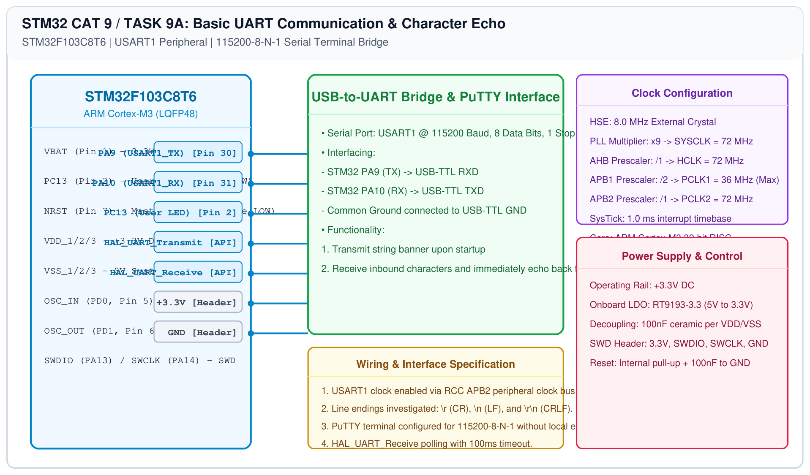

# STM32 UART Control – Task 9A: Basic UART Communication & Echo

## 1. Experiment Details
- **Experiment Identifier:** CONTINUOUS LAB EVALUATION-9 (Week 8)
- **Experiment Name:** STM32 UART Command Controlled LED
- **Hardware Platform:** STM32 Blue Pill (STM32F103C8T6) + USB-to-UART Adapter + PuTTY Terminal
- **Task Number:** TASK 9A — Basic UART Communication (Character Transmission & Immediate Echo)

---

## 2. Hardware Setup and Components
| Component | Function | Specifications |
|---|---|---|
| STM32F103C8T6 | Microcontroller | ARM Cortex-M3 clocked at 72 MHz |
| USB-to-UART Bridge | PC Serial Interface | CP2102 / CH340 3.3V TTL Adapter |
| Host PC | Serial Console | PuTTY Terminal @ 115200 Baud, 8-N-1 |

---

## 3. Circuit Diagram


---

## 4. Required Pin Connections
| STM32 Pin | Port Signal | USB-to-TTL Adapter Pin | Direction |
|---|---|---|---|
| Pin 30 | PA9 (USART1_TX) | RXD | Transmit from STM32 to PC |
| Pin 31 | PA10 (USART1_RX) | TXD | Receive from PC into STM32 |
| Header | GND | GND | Shared Reference Ground |

---

## 5. Clock Configuration & UART Parameters
- **SYSCLK:** 72.0 MHz
- **PCLK2 (APB2 Clock):** 72.0 MHz (Clock source for USART1).
- **USART1 Parameters:**
  - Baud Rate: `115200` bps
  - Word Length: `8 Bits`
  - Stop Bits: `1 Stop Bit`
  - Parity: `None`
  - Flow Control: `None`

---

## 6. Investigation of Line Endings
The evaluation sheet specifies investigating serial line ending behaviors:
- `\r` (Carriage Return, `0x0D`): Moves cursor to beginning of the current line.
- `\n` (Line Feed, `0x0A`): Advances cursor down one line without resetting horizontal column.
- `\r\n` (CRLF): Resets horizontal position and advances down, ensuring formatted terminal output.

---

## 7. Pseudocode / Code Logic
```c
char banner[] = "STM32 USART1 Online\r\nType characters to echo:\r\n";
uint8_t rx_byte;

HAL_UART_Transmit(&huart1, (uint8_t*)banner, strlen(banner), HAL_MAX_DELAY);

while (1) {
    if (HAL_UART_Receive(&huart1, &rx_byte, 1, 100) == HAL_OK) {
        /* Echo received character back to PC */
        HAL_UART_Transmit(&huart1, &rx_byte, 1, 100);
    }
}
```

---

## 8. Inference / Conclusion
- Validated full-duplex UART serial communication on USART1 using STM32 HAL drivers.
- Keystrokes sent from PuTTY were captured and immediately echoed back without packet drop.
