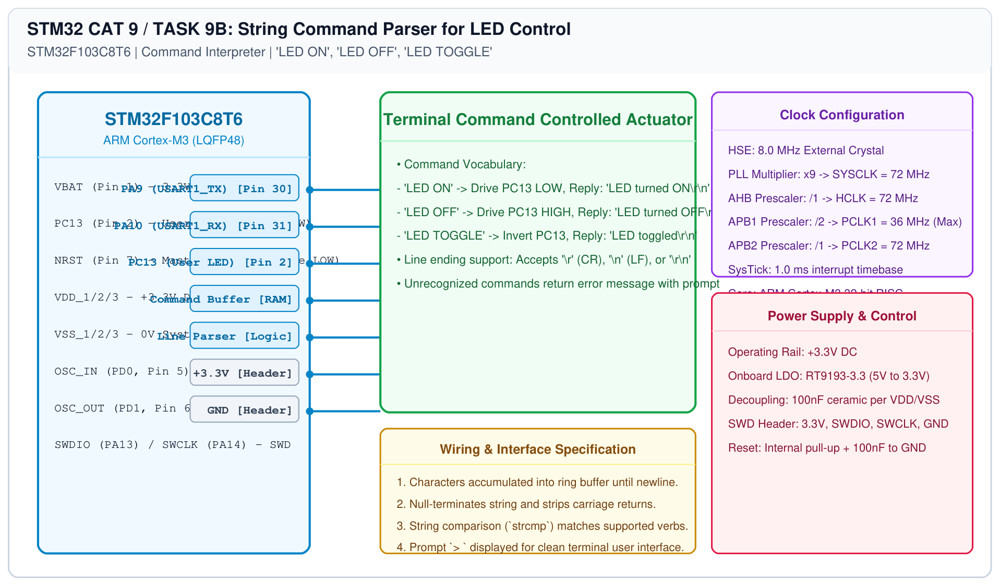

# STM32 UART Control – Task 9B: Command Parser for LED Control

## 1. Experiment Details
- **Experiment Identifier:** CONTINUOUS LAB EVALUATION-9 (Week 8)
- **Experiment Name:** STM32 UART Command Controlled LED
- **Hardware Platform:** STM32 Blue Pill (STM32F103C8T6) + PC Terminal
- **Task Number:** TASK 9B — String-Based Command Interface for Onboard LED

---

## 2. Hardware Setup and Components
| Component | Function | Description |
|---|---|---|
| STM32F103C8T6 | Command Interpreter & Controller | 72 MHz ARM Cortex-M3 |
| USB-to-UART Module | Host Interface | 115200-8-N-1 Serial Bridge |
| Onboard LED (PC13) | Visual Actuator | Active-LOW status indicator |

---

## 3. Circuit Diagram


---

## 4. Required Pin Connections
| Pin Number | MCU Pin | Function | Peripheral |
|---|---|---|---|
| Pin 30 | PA9 | USART1_TX | USB-TTL RXD |
| Pin 31 | PA10 | USART1_RX | USB-TTL TXD |
| Pin 2 | PC13 | Digital Output | Active-LOW User LED |

---

## 5. Command Set Specification
| Received Command String | Action Taken | PC Terminal Response |
|---|---|---|
| `LED ON` | PC13 driven LOW (`RESET`) | `LED turned ON\r\n` |
| `LED OFF` | PC13 driven HIGH (`SET`) | `LED turned OFF\r\n` |
| `LED TOGGLE` | PC13 logic state inverted | `LED toggled\r\n` |
| (Any other string) | No GPIO action | `Unknown command. Use: LED ON, LED OFF, LED TOGGLE\r\n` |

---

## 6. Pseudocode / Code Logic
```c
char rx_buf[64];
uint8_t rx_idx = 0;
uint8_t ch;

while (1) {
    if (HAL_UART_Receive(&huart1, &ch, 1, 100) == HAL_OK) {
        HAL_UART_Transmit(&huart1, &ch, 1, 10); /* Echo character */
        
        if (ch == '\r' || ch == '\n') {
            if (rx_idx > 0) {
                rx_buf[rx_idx] = '\0';
                
                if (strcmp(rx_buf, "LED ON") == 0) {
                    HAL_GPIO_WritePin(GPIOC, GPIO_PIN_13, GPIO_PIN_RESET);
                    uart_puts("\r\nLED turned ON\r\n> ");
                } else if (strcmp(rx_buf, "LED OFF") == 0) {
                    HAL_GPIO_WritePin(GPIOC, GPIO_PIN_13, GPIO_PIN_SET);
                    uart_puts("\r\nLED turned OFF\r\n> ");
                } else if (strcmp(rx_buf, "LED TOGGLE") == 0) {
                    HAL_GPIO_TogglePin(GPIOC, GPIO_PIN_13);
                    uart_puts("\r\nLED toggled\r\n> ");
                } else {
                    uart_puts("\r\nUnknown command\r\n> ");
                }
                rx_idx = 0;
            }
        } else if (rx_idx < sizeof(rx_buf) - 1) {
            rx_buf[rx_idx++] = ch;
        }
    }
}
```

---

## 7. Inference / Conclusion
- Constructed an interactive serial CLI parser executing GPIO hardware actuation based on ASCII command strings.
- Verified robust handling of terminal line feeds and carriage returns.
